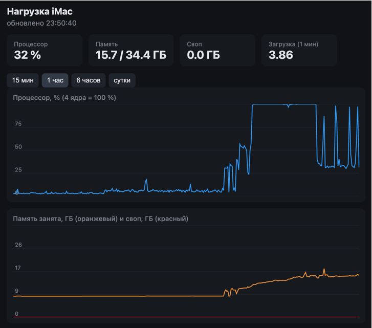

# От топовой видеокарты к компьютеру 2015 года: железо в 10 раз дешевле, ролик того же качества

## Контекст

Ко мне попал программный комплекс, который сам делает ролики для YouTube: от темы в одну строку до готового пакета для публикации. Внутри — исследование темы и проверка фактов, сценарий, озвучка, графика, подбор видео, монтаж, автоматический контроль качества, обложка и тексты. Из одного длинного фильма комплекс сам нарезает серию коротких вертикальных роликов.

**О чём эта статья.** Комплекс создавался под рабочую станцию с видеокартой NVIDIA GeForce RTX 5080. Я сначала перенёс его на компактный Mac mini на Apple Silicon, а потом заставил работать на компьютере Apple конца 2015 года — в 10 раз дешевле исходной станции. Результат: тот же 9-минутный документальный фильм, собранный в фоне за 19 минут, с той же автоматической проверкой качества. А по дороге старое железо показало узкие места, после оптимизации которых быстрее стала и основная машина.

**Старое железо — это не только дешёвые мощности. Это ещё и самый честный способ увидеть, где ваша программа тратит ваши деньги и время зря.**

## С чего я начинал: рабочая станция с топовой видеокартой

Изначально программа, когда попала ко мне, была написана под мощную рабочую станцию под Windows: процессор на 24 потока и видеокарта **NVIDIA GeForce RTX 5080**. Видеокарта была обязательной — на ней локально работали нейросети озвучки и распознавания речи. Без неё программа просто сообщала: «компьютер не подходит».

Одна только RTX 5080 стоит в несколько раз дороже компактного компьютера на Apple Silicon целиком (Mac mini на Apple M4, 16 ГБ памяти), а вся станция — ещё дороже.

**Первый шаг — я переписал комплекс под Apple Silicon.** Тяжёлые нейросети ушли с локальной видеокарты: озвучка переехала в облачный сервис, а монтаж стал кодировать видео встроенными аппаратными блоками процессора. Программа заработала на обычном компактном компьютере без дискретной видеокарты — с тем же результатом.

**Второй шаг — эта статья.** Если комплекс уже не требует видеокарты, насколько дешёвым может быть железо под ним?

## Задача

Задачу я поставил себе так: **оптимизировать процессы и код так, чтобы весь комплекс работал на старом железе — в 10 раз дешевле исходной станции — справлялся со своей работой в фоновом режиме и выдавал тот же продукт того же качества.**

В качестве подопытного я взял компьютер десятилетней давности — Apple конца 2015 года:

| | |
|---|---|
| Процессор | Intel Core i5-6600, 4 ядра, 3,3 ГГц |
| Память | 32 ГБ |
| Диск | Fusion Drive 2 ТБ (небольшой SSD + жёсткий диск) |
| Видеокарта | AMD Radeon R9 M395, 2 ГБ — комплексу не нужна |
| Система | macOS Monterey 12.7 — последняя, которую Apple даёт этой модели, обновлений больше нет |

Такая машина на вторичном рынке стоит в 5–8 раз дешевле одной только видеокарты, под которую комплекс задумывался, и более чем в 10 раз дешевле всей исходной станции.

Критерий успеха я поставил жёсткий: не «запустилось», а **тот же ролик, прошедший ту же автоматическую проверку качества**, без поблажек для старого железа.

## Почему это не «просто перенести»

Программа, написанная на быстрой машине, обрастает невидимыми допущениями:

- **инструменты** ставятся из привычных источников, которые старую систему уже не поддерживают;
- **библиотеки** тянут за собой тяжёлые зависимости, которые на новом железе ставятся за секунды, а на старом — не собираются вовсе;
- **дорогие шаги** выполняются «на всякий случай»: на быстром процессоре они занимают секунды и не попадают ни в один отчёт;
- **ресурсы** не считаются: диск, память и процессор кажутся бесконечными, пока не кончаются.

Поэтому работа разделилась на две части: добиться того, чтобы комплекс **вообще работал** на старой платформе, и сделать так, чтобы он работал **достаточно быстро** для фонового режима.

## Часть 1. Совместимость без компромиссов

**Независимая среда.** Вместо системных менеджеров пакетов, которые старую ОС бросили, я дал комплексу собственную изолированную среду. Всё необходимое ставлю в неё из официальных источников с проверкой целостности. Система при этом не трогается — ни прав администратора, ни риска сломать машину.

**Замороженные версии.** На неподдерживаемой системе любое автоматическое обновление — лотерея: следующая версия браузера или инструмента может просто не запуститься. Все компоненты, которые умеют обновляться сами, я закрепил на последней совместимой версии, а рабочие версии сохранил архивом для мгновенного отката.

**Только необходимое.** Ревизия зависимостей показала, что часть тяжёлых библиотек комплекс тянул «по наследству» — для функций, которыми давно не пользуется. На старой платформе именно они не собирались. Я их убрал — и получил окружение в разы легче и стабильнее.

**Перенос со сверкой.** Данные и проекты я переношу между машинами с проверкой каждого файла: источник удаляется только после полного совпадения на обеих сторонах. Внешний архивный носитель подключается только на чтение — его невозможно случайно испортить.

**Фоновый режим.** Все сервисы комплекса запускаются сами при старте машины и поднимаются заново после сбоя. Рядом я поставил лёгкий монитор нагрузки: процессор, память, диск и самые прожорливые процессы в динамике — чтобы видеть, как старое железо справляется, не подходя к нему.

## Часть 2. Скорость: где программа тратила время зря

> **Медленная машина — лучший профайлер. То, что на новом компьютере занимает 20 секунд и никого не волнует, на старом занимает 13 минут — и только тогда становится видно, что это можно делать в шесть раз быстрее.**

Я прогнал полный цикл на старом железе и смотрел, на каком шаге уходит время. Нашлись три больших резерва.

### Поиск видеоматериала: в 7–30 раз быстрее

Подбор видео для сцен был самым долгим шагом ещё до переезда. Программа последовательно опрашивала все источники, включая медленные архивы, даже когда сцене нужен был обычный современный кадр.

Я перестроил логику: быстрые источники опрашиваются параллельно, медленные — только когда они действительно нужны. И главное — **всё однажды скачанное теперь хранится в собственной библиотеке с поиском**. Каждый следующий ролик сначала ищет у себя и только потом идёт в интернет. Шаг, занимавший около 15 минут, теперь укладывается в 30 секунд — 2 минуты, и становится быстрее с каждым новым роликом.

### Кодирование видео: в 6–7 раз быстрее

Помимо основного видео комплекс делает облегчённую копию для площадок, где важен размер файла. На новой машине — секунды. На старой — 13 минут, почти половина всей сборки.

Оказалось, что эту копию кодировал центральный процессор, хотя в процессоре 2015 года есть отдельный аппаратный блок для видео. Я переключил кодирование на него — **13 минут превратились в 2**, качество при нужном битрейте то же. На случай, если аппаратного блока нет, программа сама возвращается к старому способу.

### Синхронизация текста и голоса: от минут к мгновенному

Субтитры в моих роликах подсвечивают слово, которое звучит прямо сейчас, а графика реагирует на конкретные слова диктора. Для этого нужно знать время каждого слова. Раньше после озвучки запись заново «прослушивалась» моделью распознавания речи — тяжёлая работа для старого процессора.

Но сервис озвучки и так знает, когда произносит каждое слово, — нужно было просто попросить его это сообщить. Я так и сделал: теперь тайминги приходят вместе с голосом, без отдельного распознавания. Результат оказался не только быстрее, но и **точнее**: распознавание иногда путало похожие слова и сдвигало время, а исходные тайминги этих ошибок не имеют.

> **Прежде чем считать что-то самому, спросите сервис, что он уже знает. Я распознавал речь, которую сам же и заказал.**

## Результат

Контрольный тест — полноценный 9-минутный документальный фильм.

| | Исходная станция | Apple Silicon | Компьютер 2015 года |
|---|---|---|---|
| Стоимость железа | 1× | ≈ 0,25× | **≈ 0,1× и меньше** |
| Дискретная видеокарта | обязательна (NVIDIA GeForce RTX 5080) | не нужна\*\* | не нужна\*\* |
| Монтаж фильма | ~7 мин* | ~6 мин | ~18 мин |
| Вся сборка | ~7,5 мин* | ~6 мин | **~19 мин** после оптимизации (было 30) |
| Загрузка процессора | низкая | низкая | в среднем ~80 % |
| Память | 32 ГБ, файл подкачки до 20 ГБ | 16 ГБ, файл подкачки до 20 ГБ | 32 ГБ, занято до ~55 %, без подкачки |
| Автоматическая проверка качества | 0 ошибок | 0 ошибок | **0 ошибок** |

\* Оценка: после оптимизации под Apple Silicon компактный компьютер собирает ролик примерно на 20 % быстрее исходной станции с видеокартой.

\*\* Небольшая оговорка: речь на Apple Silicon и на компьютере 2015 года генерирует облачный сервис — за небольшие деньги, с качеством и возможностями выше, чем у локальной озвучки на исходной станции. Озвучка 9-минутного фильма — около 7 500 символов текста — обходится примерно в 0,15–0,25 $ на годовом тарифе сервиса (около 8 $ в месяц за 121 тысячу кредитов; быстрая модель списывает примерно полкредита за символ). Этого тарифа хватает на десятки фильмов и коротких роликов в месяц.

Итог по фильму: весь 9-минутный документальный фильм старая машина собирает **за 19 минут** — с той же автоматической проверкой качества и тем же результатом, что и на станции с RTX 5080.

*Монитор нагрузки во время сборки фильма: 18 минут монтажа старый компьютер загружен на 100 % — все четыре ядра работают на пределе. Памяти при этом занято меньше половины, подкачки нет. Короткие пики после — это сценарист готовит следующие ролики.*

Монтаж на старой машине идёт примерно в три раза медленнее. Но в фоновом режиме это не имеет значения: ночь длинная, а фильм на выходе **тот же самый**.

И ещё один эффект, ради которого стоило всё это затевать: **оптимизации, найденные на старом железе, ускорили и новое.** Поиск видео, кодирование и синхронизация теперь быстрее везде.

## Что дальше: распределённое производство

Следующий шаг — перестать думать о «машине, которая делает ролик», и разделить производство на две стадии по характеру нагрузки.

**Подготовка — на дешёвой станции, в фоне.** Самая долгая по времени часть работы почти не нагружает процессор: исследование темы и проверка фактов, сценарий, подбор и скачивание видео, озвучка, графика. Здесь основное время уходит на ожидание внешних сервисов и сети, а не на вычисления. Это идеальная работа для старого компьютера: я ставлю задачи на исследование, и в течение дня, ночью, в фоне станция собирает полностью готовый к монтажу проект — сценарий, голос, материалы, разметку сцен.

**Сборка — на быстрой машине, за минуты.** Готовый проект станция сама отдаёт на мощный компьютер: мой рабочий или арендованный на время облачный сервер с хорошим процессором и видеокартой. Там остаётся только тяжёлая и короткая часть — монтаж и кодирование. Она занимает считанные минуты, после чего готовый ролик возвращается в архив станции.

Что это даёт:

- **мощная машина занята только тем, для чего она нужна**, — минуты сборки вместо часов ожидания;
- **аренду можно включать по факту**: пришла пачка готовых проектов — поднял сервер, собрал за полчаса, выключил. Плачу за минуты, а не за простой;
- **очередь не встаёт**: пока одни проекты собираются на быстрой машине, станция уже готовит следующие;
- **масштабирование становится линейным**: больше роликов — больше дешёвых станций подготовки, а быстрые сборщики подключаются по необходимости.

Для этого нужно, чтобы проект был полностью переносимым: всё, что нужно для сборки, лежит в одной папке, без привязки к конкретной машине. Большую часть этой работы я уже сделал при переезде на старое железо — проекты переносятся между машинами и собираются на любой из них с одинаковым результатом.

## Что забрать с собой

1. **Проверьте старое железо, прежде чем покупать новое.** Компьютер десятилетней давности тянет полный цикл тяжёлого конвейера — медленнее, но с тем же результатом.
2. **Фоновая работа не требует скорости — она требует надёжности.** Автозапуск, восстановление после сбоев и мониторинг важнее лишних гигагерц.
3. **Изолируйте среду программы от системы.** Своё окружение, официальные источники, проверка целостности — и никакой зависимости от того, поддерживает ли производитель вашу ОС.
4. **На неподдерживаемой платформе замораживайте версии.** Всё, что обновляется само, — закрепить и сохранить архивом.
5. **Проведите ревизию зависимостей.** Часть «тяжести» почти любой программы — наследство от функций, которыми давно не пользуются.
6. **Запустите программу на медленной машине и посмотрите, где она тратит время.** Узкие места, невидимые на быстром железе, там бросаются в глаза.
7. **Ищите готовое в железе и в сервисах.** Аппаратный блок видео, данные, которые внешний сервис уже посчитал, — часто ускорение лежит на поверхности.
8. **Делите работу между машинами по характеру нагрузки.** Долгое и лёгкое — исследование, сценарий, поиск, озвучка, архив — отдайте дешёвой станции в фоне. Короткое и тяжёлое — монтаж — отправляйте на быструю машину или арендованный сервер, который работает минуты, а не сутки.

## Итог

Комплекс, который начинался как программа «только для мощной станции с топовой видеокартой», сначала переехал на компактный Apple Silicon без видеокарты, а потом — на компьютер 2015 года. И на каждом шаге выдавал тот же ролик, прошедший ту же проверку качества.

Я хотел найти работу для старого компьютера. Получил второй полноценный цех производства роликов — в десять раз дешевле, в фоновом режиме, с тем же качеством на выходе. И три ускорения, которые теперь работают и на основной машине.

Ни одно из них я бы не нашёл, если бы не запустил программу на медленном железе.

А дальше старая станция станет фабрикой готовых проектов: днём и ночью в фоне она будет исследовать, писать и озвучивать, а быстрый компьютер или арендованный сервер будет за считанные минуты превращать эти проекты в готовые ролики.
